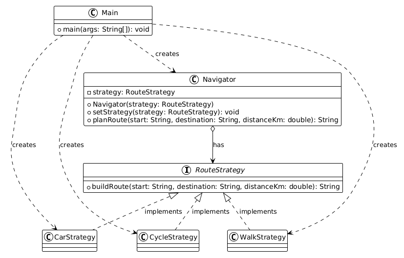

# ASSIGNMENT #5 - STRATEGY PATTERN

Course: ShP-2216 – Software Design Patterns (OP 6B06102)  
Name: Smat Zhangir  
Group: SE-2522  
Topic: Option A

## 1. Introduction

I chose navigation and route planning. The algorithm family is estimating travel time for different transport modes: car, walking, and cycling. All strategies use the same start, destination, and distance, but each has its own average speed. These are simple estimates, not real map directions.

## 2. UML Class Diagram



## 3. Clean Code

### 1. Replace conditionals with polymorphism

In my implementation, Navigator calls the selected strategy:

```java
return strategy.buildRoute(start, destination, distanceKm);
```

This keeps the Navigator class simple because it doesn't need to know which transport mode is being used.

### 2. Meaningful names

I used names that clearly describe what each class does. For example, CarStrategy, WalkStrategy, and CycleStrategy make it easy to understand which transport mode they represent.

```java
public class WalkStrategy implements RouteStrategy {
```

### 3. Single Responsibility Principle

Each strategy class is responsible for calculating travel time for only one transport mode. For example, CarStrategy handles the car calculation:

```java
public class CarStrategy implements RouteStrategy {
    @Override
    public String buildRoute(String start, String destination, double distanceKm) {
        double minutes = distanceKm / 40 * 60;
        return String.format("Car: %s to %s, %.1f km, about %.0f minutes", start, destination, distanceKm, minutes);
    }
}
```

### 4. Depending on abstractions

The Navigator class stores a reference to the RouteStrategy interface instead of a specific strategy class.

```java
private RouteStrategy strategy;
```

For example, if I used `private CarStrategy strategy;`, the Navigator would be tied to the car implementation.

### 5. Open/Closed Principle

The program is designed so new transport strategies can be added without modifying the existing Navigator class.

For example, in Main.java, I can switch strategies using:

```java
navigator.setStrategy(new CycleStrategy());
System.out.println(navigator.planRoute("Home", "University", 6));
```

If I wanted to add a bus transport mode, I would create a new BusStrategy class that implements RouteStrategy.

I would only need to add the new class and select it in the client code. The Navigator and existing strategies wouldn't need to be changed.

## 4. Strategy vs. State

Strategy and State are similar because both use interfaces and separate classes to change behavior, the main difference is why the behavior changes.

In Strategy, the client chooses which algorithm to use, Main selects whether the route should be calculated for a car, walking, or cycling.

State is used when an object's behavior depends on its current state, and that state may change during its lifecycle.

Strategy fits my project better because transport modes are algorithms that the client chooses, not states that the Navigator goes through.

## 5. Conclusion

The Strategy pattern helped me separate different travel-time calculations and keep the Navigator class simple. It also makes the program more flexible because I can switch strategies while the program is running or add new ones later.

## 6. GitHub Repository

https://github.com/smatD/assignment-5-strategy-pattern